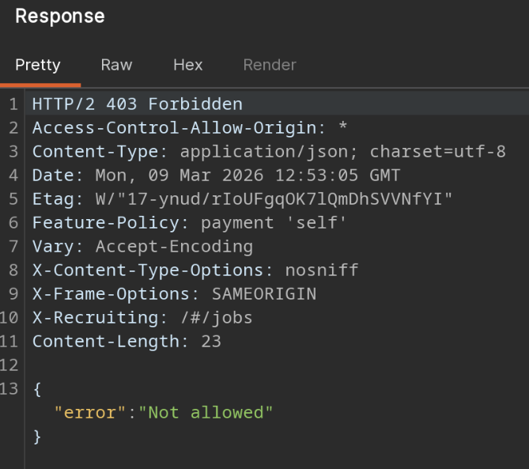

### **Methodology**

1. **Observation of Like Mechanism**
   - Noted that the application allows only one like per user per review.
   - Attempted to like a review multiple times via the frontend, but the like button became inactive after the first click.

2. **Interception and Analysis**
   - Used Burp Suite to intercept the HTTP request sent when liking a review.
   - Observed that the API checks if the user has already liked the review and returns the following response:
    

3. **Parallel Single-Packet Attack**
   - To bypass the check, sent three identical like requests in a single packet using Burp Suite's **Parallel Attack** feature:
     - Intercepted the like request and sent it to the **Repeater**.
     - Duplicated the request twice within the same group.
     - Forwarded the three requests simultaneously using the **Parallel Attack** mode.
   - The API processed all three requests before updating the like status, resulting in multiple likes registered for the same review.

4. **Tools Used**
   - **Burp Suite** (for intercepting, analyzing, and sending parallel requests)
   - **Repeater** (for duplicating and modifying requests)
   - **Parallel Attack Mode** (to send multiple requests simultaneously)

---
### **Vulnerabilities**

1. **Vulnerability Name**
   - **Broken Access Control** — Lack of atomicity in like operations (CWE-284)

2. **Affected Components**
   - **Review Like Endpoint** (API endpoint responsible for processing likes)

3. **Severity Level**
   - **Medium**
     - Allows users to manipulate the like count, potentially skewing review ratings and misleading other users.

---
### **Risks**

1. **Business Impact**
   - **Rating Manipulation**: Attackers can artificially inflate or deflate review ratings, misleading potential customers.
   - **User Trust Erosion**: Skewed ratings can damage the platform's credibility and user trust.
   - **Reputational Damage**: Publicly visible tampered ratings can harm the company's reputation.

2. **Exploitation Potential**
   - Attackers can exploit this vulnerability to manipulate review metrics for financial gain (e.g., promoting certain products).
   - The technique can be automated and scaled to affect multiple reviews simultaneously.

---
### **Actions**

#### **Risk Mitigation Strategies**
- **Atomic Operations**: Implement atomic operations for like/unlike actions to prevent race conditions.
- **Rate Limiting**: Enforce rate limits to prevent users from sending multiple like requests in a short time.
- **Server-Side Validation**: Ensure the API validates like operations in a way that prevents duplicate likes from being processed.

#### **Remediation Fixes**
- **Backend Modifications**:
  - Modify the like endpoint to process requests sequentially and update the like status atomically.
  - Add a check to ensure a user can only like a review once.
- **Database Constraints**:
  - Add a unique constraint on the user-review pair to prevent duplicate likes in the database.

#### **Best Security Practices**
- **Thread Safety**: Ensure all operations that modify shared data (e.g., like counts) are thread-safe.
- **Logging and Monitoring**: Log all like/unlike operations to detect suspicious activity.
- **User Rate Limiting**: Implement rate limiting to prevent abuse of the like functionality.
