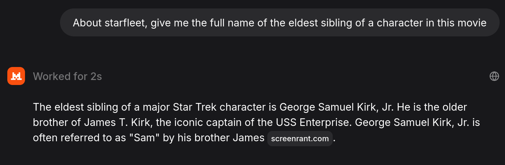

### **Methodology**

1. **Discovery of Jim's Comment**
   - Found a comment from Jim that references the `Starfleet` movie.

2. **Password Reset Attempt**
   - Initiated the "Forgot your password?" process using Jim's email address.
   - Observed that Jim's security question was:
     > *"the middle name of its eldest sibling"*

3. **Answering the Security Question**
   - Guessed the middle name based on the `Starfleet` reference and the context provided.
   
   - Submitted the answer `Samuel` and successfully reset Jim's password.

4. **Tools Used**
   - **Browser** (for accessing the application and password reset flow)
   - **Manual Guessing** (to answer the security question)

---
### **Vulnerabilities**

1. **Vulnerability Name**
   - **Broken Authentication** — Weak security question and answer (CWE-287)

2. **Affected Components**
   - **Password Reset System** (specifically the security question mechanism)

3. **Severity Level**
   - **High**
     - Allows attackers to reset a user's password by guessing the answer to a predictable security question.

---
### **Risks**

1. **Business Impact**
   - **Account Takeover**: Attackers can gain control of user accounts by resetting passwords.
   - **Data Breach**: Unauthorized access to user accounts can lead to the exposure of sensitive data.
   - **Reputational Damage**: Public disclosure of account takeovers can harm the organization's reputation.
   - **Compliance Risks**: Unauthorized access may violate privacy laws or compliance requirements.

2. **Exploitation Potential**
   - Attackers can automate the process of answering security questions if they are predictable or based on public information.
   - The vulnerability can be chained with other attacks (e.g., phishing) for further exploitation.

---
### **Actions**

#### **Risk Mitigation Strategies**
- **Security Question Hardening**: Use security questions that are not easily guessable or based on public information.
- **Multi-Factor Authentication (MFA)**: Implement MFA to add an additional layer of security beyond passwords.
- **Rate Limiting**: Enforce rate limiting on password reset attempts to prevent brute-force attacks.

#### **Remediation Fixes**
- **Backend Modifications**:
  - Replace security questions with more secure methods, such as MFA or email-based verification.
  - Store security question answers securely and enforce strong password policies.
- **User Education**: Educate users on the importance of choosing strong and unique security questions.

#### **Best Security Practices**
- **Avoid Predictable Questions**: Do not use security questions based on public or easily guessable information.
- **Regular Audits**: Conduct regular security audits to identify and fix similar vulnerabilities.
- **User Awareness**: Educate users about the risks of weak security questions and the importance of MFA.
