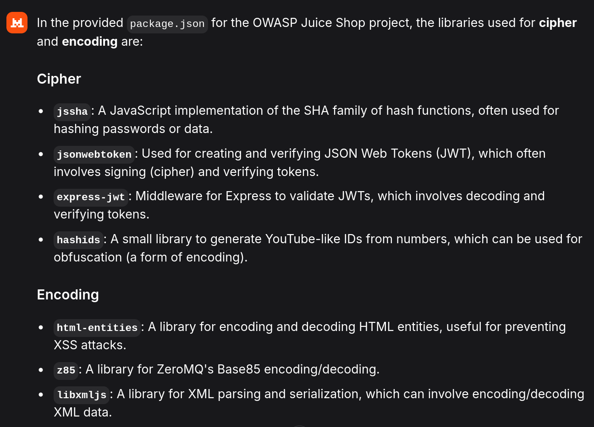
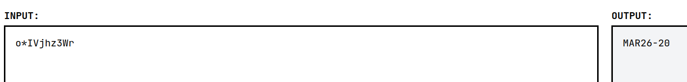
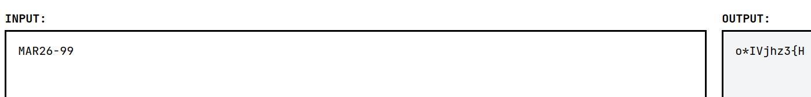

## Methodology

1. **Initial Discovery**
   - Obtained a coupon code from Bluesky or Reddit, formatted as `o*IVjhz3Wr`.
   - Attempted to identify the encoding scheme using **dcode cipher identifier**, but no matches were found.

2. **Dependency Analysis**
   - Revisited the previously discovered `package.json` file to identify libraries related to cipher and encoding.

   - Identified `z85` as a potential encoding scheme used for the coupon.

3. **Decoding the Coupon**
   - Used a **Z85 decoder** to decode the coupon code.
   - Discovered that the decoded coupon follows the format: `[Month][Year]-[Redemption Amount]`:

4. **Forging a New Coupon**
   - Crafted a new coupon with a 99% reduction amount using the same format:
    
    
   - Encoded the forged coupon back into Z85 format using a **Z85 encoder**.

5. **Validation**
   - Redeemed the forged coupon on the website, confirming its validity and triggering the challenge flag.

### Tools Used
- **dcode Cipher Identifier**: For initial cipher analysis.
- **Z85 Decoder/Encoder**: For decoding the original coupon and encoding the forged coupon.
- **Le Chat**: For identifying potential encoding libraries from `package.json`.

---

## Vulnerabilities

- **Vulnerability Type**: Insecure Encoding (CWE-326)
- **Affected Component**: Coupon generation and validation system
- **Severity Level**: **High**
  - Allows attackers to forge valid coupons by reverse-engineering the encoding scheme, leading to unauthorized discounts or financial loss.

---

## Risks

- **Business Impact**:
  - **Financial Loss**: Forged coupons can be redeemed for unauthorized discounts, directly impacting revenue.
  - **Fraudulent Activity**: Potential for widespread coupon abuse, leading to significant financial and operational consequences.
  - **Reputational Damage**: Loss of customer trust due to perceived security weaknesses in coupon validation.
  - **Operational Disruption**: Increased costs for detecting and mitigating fraudulent coupon redemptions.

---

## Actions

### Mitigation Strategies
- **Secure Encoding**: Use cryptographically secure encoding schemes (e.g., HMAC, digital signatures) for coupon generation.
- **Server-Side Validation**: Implement strict server-side validation to verify coupon integrity and prevent forgery.
- **Rate Limiting**: Apply rate limiting to coupon redemption to detect and prevent abuse.

### Remediation Fixes
- **Coupon Format Complexity**: Increase the complexity of coupon formats and use unique, non-predictable identifiers.
- **Logging and Monitoring**: Maintain detailed logs of coupon redemptions and monitor for unusual patterns or abuse.
- **Multi-Factor Verification**: Require additional verification steps for high-value coupon redemptions.

### Best Security Practices
- **Regular Security Audits**: Conduct periodic security audits and penetration tests to identify and address vulnerabilities in coupon systems.
- **Developer Training**: Train developers on secure coding practices, with a focus on cryptographic security and encoding.
- **Incident Response Plan**: Develop and maintain an incident response plan to quickly address and mitigate coupon forgery and fraud.

