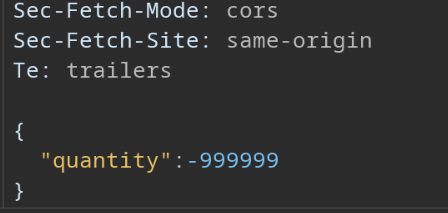
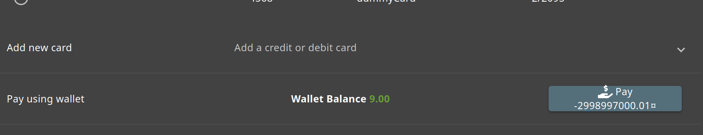

## Methodology

1. **Initial Analysis**
   - Initially considered creating a coupon with an extreme discount (e.g., -200%) but realized a simpler approach was possible.
   - Recognized that the goal was to increase account balance, which required placing an order with a negative total price.

2. **Identifying the Attack Vector**
   - Added an expensive product to the basket to maximize the potential financial gain.
   - Navigated to the basket and attempted to modify the product quantity, intercepting the request with **Burp Suite**.

3. **Manipulating the Product Quantity**
   - Intercepted the request to update the product quantity and modified the `amount` parameter to a negative value.

   - Forwarded the modified request to the server.

4. **Checkout Process**
   - Proceeded to checkout, where the order total reflected the negative price.
   - Completed the "payment" process, which resulted in the account balance increasing by the absolute value of the negative total.

5. **Validation**
   - Confirmed the successful exploitation by observing the increased account balance and receiving the challenge flag.

### Tools Used
- **Burp Suite**: For intercepting and modifying HTTP requests.
- **Basket and Checkout Analysis**: To identify and exploit the vulnerability in the order process.

---

## Vulnerabilities

- **Vulnerability Type**: Broken Access Control (CWE-284), Price Manipulation
- **Affected Component**: Basket update and checkout endpoints
- **Severity Level**: **Critical**
  - Allows users to manipulate order prices, resulting in unauthorized financial gain and potential revenue loss.

---

## Risks

- **Business Impact**:
  - **Financial Loss**: Direct loss of revenue due to negative order exploitation.
  - **Fraudulent Activity**: Potential for widespread abuse, leading to significant financial and operational consequences.
  - **Reputational Damage**: Loss of customer trust and credibility due to perceived security weaknesses in financial transactions.
  - **Operational Costs**: Increased costs for detecting and mitigating fraudulent transactions and restoring financial integrity.

---

## Actions

### Mitigation Strategies
- **Server-Side Validation**: Implement strict server-side validation for all parameters related to product quantities and prices.
- **Input Sanitization**: Sanitize and validate all user-supplied input, especially in financial workflows.
- **Price Integrity Checks**: Ensure that order totals are calculated and validated on the server-side to prevent manipulation.

### Remediation Fixes
- **Strict Parameter Validation**: Validate that product quantities and prices are within expected ranges and formats.
- **Transaction Logging**: Maintain detailed logs of all order modifications and transactions for auditing and fraud detection.
- **Multi-Factor Authentication**: Require additional authentication steps for sensitive transactions, such as order checkout.

### Best Security Practices
- **Regular Security Audits**: Conduct periodic security audits and penetration tests to identify vulnerabilities in financial processes.
- **Developer Training**: Train developers on secure coding practices, with a focus on financial security and access control.
- **Incident Response Plan**: Develop and maintain an incident response plan to quickly address and mitigate financial fraud and security breaches.
