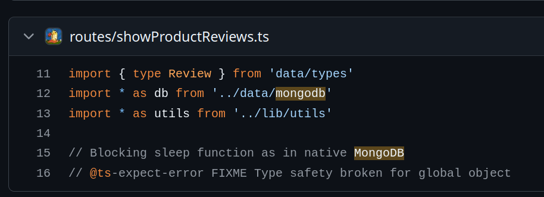
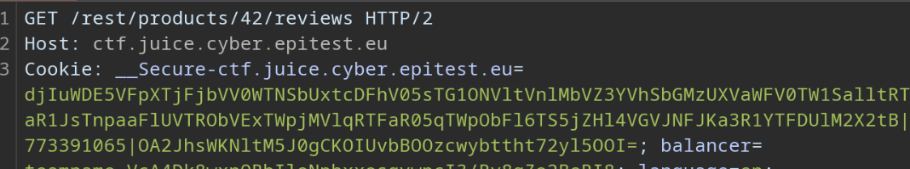
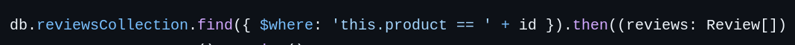
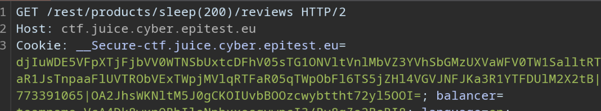

## Methodology

1. **Initial Research**
   - Researched NoSQL databases, focusing on MongoDB as the most common NoSQL database.
   - Investigated potential attack vectors for NoSQL injection, particularly Denial of Service (DoS).

2. **Identifying the Target**
   - Reviewed the source code for references to MongoDB or NoSQL.
   - Discovered a relevant file with comments about NoSQL DoS attack protection, indicating the target was related to product reviews.

3. **Intercepting the API Call**
   - Used **Burp Suite** to intercept and analyze the API call made when accessing product reviews.
   - Identified the `productId` parameter as a potential injection point within the NoSQL query.

4. **Crafting the Exploit**
   - Observed that the `id` parameter was directly embedded in the NoSQL query, making it vulnerable to injection.

   - Injected a `sleep(200)` command into the `productId` parameter using **Burp Repeater** to induce a delay, effectively causing a DoS.
- 

### Tools Used
- **Burp Suite**: For intercepting, modifying, and repeating API calls.
- **Source Code Analysis**: To identify vulnerable endpoints and understand query construction.

---

## Vulnerabilities

- **Vulnerability Type**: NoSQL Injection (CWE-943)
- **Affected Component**: Product review API endpoint
- **Severity Level**: **High**
  - Allows attackers to disrupt service availability by injecting malicious payloads, leading to excessive resource consumption.

---

## Risks

- **Business Impact**:
  - **Service Disruption**: Unavailability of product reviews, impacting user experience and potentially leading to loss of sales.
  - **Reputational Damage**: Loss of customer trust due to service instability and perceived lack of security.
  - **Resource Exhaustion**: Overloading server resources, affecting overall system performance and availability.

---

## Actions

### Mitigation Strategies
- **Input Validation**: Implement strict validation for all user-supplied input, especially parameters used in NoSQL queries.
- **Query Parameterization**: Use parameterized queries or prepared statements to separate user input from query logic.
- **Rate Limiting**: Apply rate limiting to API endpoints to prevent abuse and mitigate the impact of DoS attacks.

### Remediation Fixes
- **Code Review**: Conduct a thorough review of the application code to identify and fix NoSQL injection vulnerabilities.
- **Security Patching**: Update and patch the NoSQL database and related libraries to the latest secure versions.

### Best Security Practices
- **Security Audits**: Perform regular security audits and penetration testing to identify and address vulnerabilities.
- **Developer Training**: Train developers on secure coding practices, with a focus on NoSQL injection and DoS prevention.
- **Incident Response Plan**: Develop and maintain an incident response plan to quickly address and mitigate security breaches.
