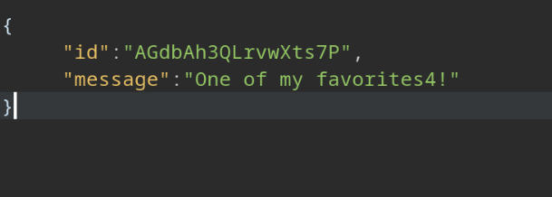
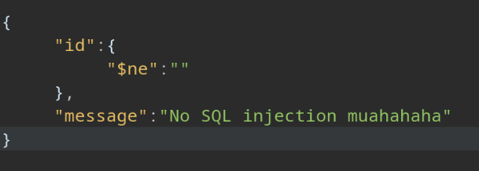
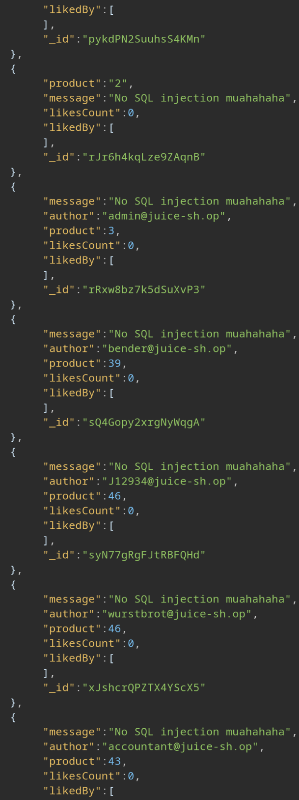

## Methodology

1. **Initial Reconnaissance**
   - Leveraged prior knowledge from the **NoSQL DoS** challenge to confirm the search bar and product reviews are stored in a MongoDB database.
   - Identified the review update functionality as a potential target for NoSQL injection.

2. **Intercepting the Update Request**
   - Used **Burp Suite** to intercept the HTTP request sent when updating a review.
   - Analyzed the request to understand the structure: the `id` parameter selects the review, and the `message` parameter contains the new review content.

3. **Crafting the NoSQL Injection**
   - Researched NoSQL injection techniques and identified the use of `"$ne": ""` to match all non-null `id` values.
   - Modified the intercepted request to inject the NoSQL operator, targeting all reviews in the database.

4. **Executing the Attack**
   - Sent the modified request via **Burp Repeater**.
   - Confirmed success by observing the response, indicating all reviews in the NoSQL database were updated.

### Tools Used
- **Burp Suite**: For intercepting, modifying, and repeating HTTP requests.
- **Documentation/LLM**: For researching NoSQL injection techniques and operators.

---

## Vulnerabilities

- **Vulnerability Type**: NoSQL Injection (CWE-943)
- **Affected Component**: Review update API endpoint
- **Severity Level**: **Critical**
  - Allows unauthorized mass manipulation of data, potentially leading to integrity violations and reputational damage.

---

## Risks

- **Business Impact**:
  - **Data Integrity Violation**: Unauthorized modification of all reviews, leading to loss of trust and misinformation.
  - **Reputational Damage**: Customers may perceive the platform as insecure, resulting in loss of business.
  - **Operational Disruption**: Potential need for manual review restoration, increasing operational costs and downtime.

---

## Actions

### Mitigation Strategies
- **Input Validation**: Implement strict validation for all user-supplied input, especially in NoSQL queries.
- **Query Sanitization**: Use libraries or frameworks that automatically sanitize NoSQL queries to prevent injection.
- **Least Privilege Principle**: Ensure database users have minimal permissions, limiting the impact of potential injections.

### Remediation Fixes
- **Code Review**: Conduct a thorough review of the application code to identify and fix NoSQL injection vulnerabilities.
- **Security Patching**: Update MongoDB and related libraries to the latest secure versions.

### Best Security Practices
- **Regular Security Audits**: Schedule periodic security audits and penetration tests to identify and address vulnerabilities.
- **Developer Training**: Train developers on secure coding practices, with a focus on NoSQL injection prevention.
- **Incident Response Plan**: Develop and maintain an incident response plan to quickly address and mitigate security breaches.
