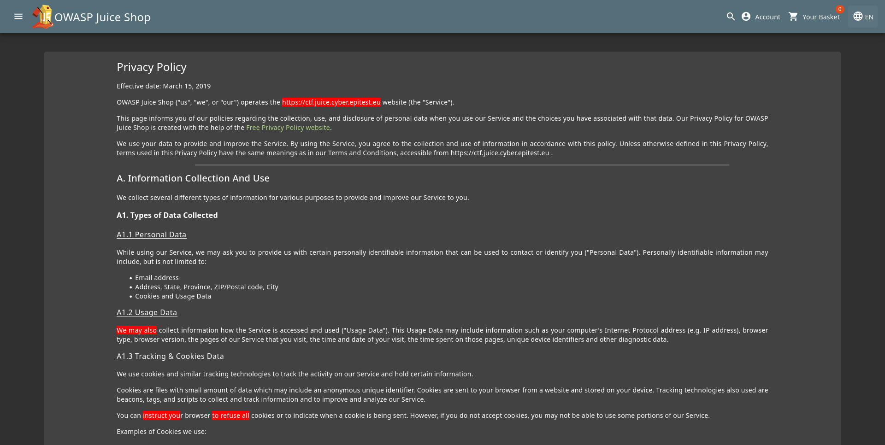

## **Methodology**

1. **Initial Inspection**:
   - Reviewed the privacy policy page for visible clues or anomalies.
   - Noticed that certain words were highlighted when hovered over with the mouse.

2. **Code Inspection**:
   - Inspected the page source to identify the class associated with the highlighted words.
   - Discovered that all highlighted words belonged to the `hot` class.

3. **Visualization**:
   - Applied a red background to all elements with the `hot` class for better visibility.
   - Extracted the following words:
     - `https://ctf.juice.cyber.epitest.eu`
     - `We may also`
     - `instruct you`
     - `to refuse all`
     - `reasonably necessary`
     - `responsibility`
    

4. **URL Construction**:
   - Hypothesized that the words formed a URL path.
   - Constructed the URL:
     ```
     https://ctf.juice.cyber.epitest.eu/We may also/instruct you/to refuse all/reasonably necessary/responsibility
     ```
   - Attempted URL encoding (replacing spaces with `%20`), which did not work.
   - Replaced spaces with `/`, resulting in a 404 error but revealing a hidden path:
     ```
     /juice-shop/frontend/dist/frontend/assets/private/thank-you.jpg
     ```

5. **Flag Discovery**:
   - Accessed the revealed path and obtained the flag.

---

## **Vulnerabilities**

- **Vulnerability**: **Hidden Information (CWE-530: Exposure of Sensitive Information Through Hidden Elements)**
- **Affected Component**: Privacy policy page (frontend)
- **Severity Level**: **Medium**

---

## **Risks**

- **Business Impact**:
  - Hidden URLs or paths can expose sensitive files or directories.
  - Potential for unauthorized access to private assets, leading to data leaks or reputational damage.

---

## **Actions**

### **Mitigation Strategies**
- **Code Review**: Conduct regular reviews of frontend code to identify and remove hidden elements or obfuscated content.
- **Automated Scanning**: Use tools to scan for hidden text, paths, or elements in web pages.

### **Remediation Fixes**
- **Remove Hidden Content**: Ensure all text and paths are visible and intended for public access.
- **Access Control**: Implement strict access controls for private directories and assets.

### **Best Security Practices**
- **Transparency**: Avoid hiding information in plain sight; ensure all content is clearly visible and documented.
- **User Training**: Educate developers about the risks of exposing sensitive information through hidden elements.

---